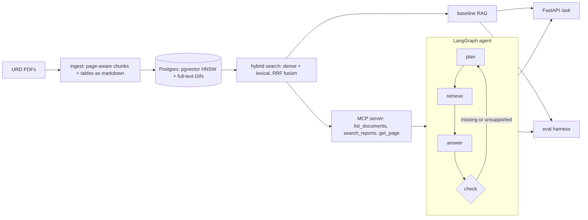

# bank-reports-agent

[](https://github.com/hajar6883/bank-reports-agent/actions/workflows/ci.yml)

Ask questions across the annual reports (universal registration documents) of French banks, with answers that cite the page they come from.

The project compares two ways of doing that on a hand-labelled question set:

- **Baseline RAG:** retrieve the top passages for the question and answer in one LLM call.
- **Agent:** a LangGraph state machine that plans sub-queries (one per bank and metric), retrieves through an **MCP server**, answers, then has a verifier check that every figure is supported, and searches again if it isn't.

The question it answers: *how much accuracy does the agent buy on multi-bank and table questions, and at what cost in tokens and latency?*

## Architecture



| Piece | Choice | Why |
|---|---|---|
| Chunking | per page, ~1,200 chars, 200 overlap; tables extracted separately as markdown | a citation is always one page; tables are where report RAG breaks |
| Store | one Postgres with pgvector + full-text search | hybrid search without a second system |
| Fusion | Reciprocal Rank Fusion | no score calibration between BM25-style and cosine scores |
| Tool interface | MCP server over stdio | the same tools work for this agent, Claude Desktop or any MCP client |
| Agent | explicit graph, bounded retries | predictable cost and inspectable traces, rather than an open ReAct loop |
| Eval | context recall, deterministic number match, LLM judge, citation check, tokens, latency | an LLM judge alone can be fooled; the number match can't |

More detail and the trade-offs: [docs/DESIGN.md](docs/DESIGN.md).

## Quickstart

```bash
python -m venv .venv && source .venv/bin/activate
pip install -e ".[dev,openai,local]"        # or anthropic / mistral instead of openai
cp .env.example .env                         # add your API key, choose models
docker compose up -d                         # Postgres + pgvector on :5433
```

Put the reports in `data/raw/`, named `<code>_<year>_urd.pdf` with the codes in `data/banks.yaml`
(`bnp_2025_urd.pdf`, `sg_2025_urd.pdf`, `casa_2025_urd.pdf`, `bpce_2025_urd.pdf`). Download them from each bank's
investor-relations page; the reports are not redistributed in this repo.

```bash
bra ingest data/raw/ --max-pages 40          # quick smoke test first
bra reset && bra ingest data/raw/            # full run (idempotent: re-running skips known files)
bra ask "Compare the CET1 ratios of BNP Paribas and Société Générale at end-2025"
bra ask "..." --mode rag                     # baseline, for comparison
bra eval --limit 5                           # cheap check of the harness
bra eval --modes rag,agent_nocheck,agent     # the real run
bra serve                                    # POST /ask {"question": ..., "mode": "agent"}
```

No API key yet? `LLM_MODEL=fake JUDGE_MODEL=fake EMBED_MODEL=hash:256` runs everything with a deterministic stand-in. It
checks that the plumbing works and nothing else; never report its numbers.

## Evaluation

`data/questions.yaml` holds 40 questions (single bank, multi-bank, table). Each needs a reference answer and its source
pages, filled by hand from the PDFs: `page` is the PDF page index your viewer shows, not the printed page number.
Questions without an answer are skipped, so the set can be filled progressively.

| Metric | Meaning |
|---|---|
| context recall | share of gold pages present in what the LLM actually saw |
| number match | every figure in the reference appears in the answer (deterministic, handles `12,9 %` vs `12.9%`) |
| judge correct | an LLM judge compares the answer with the reference (use a different or stronger model than `LLM_MODEL`) |
| cites gold page | at least one citation points at a gold page |
| tokens, LLM calls, latency, cost | per question; cost needs `PRICE_*_PER_M` in `.env` |

The report also includes a retrieval-only ablation (dense vs lexical vs hybrid recall@k) that costs no LLM calls.

## Use the MCP server from Claude Desktop (or any MCP client)

```json
{
  "mcpServers": {
    "bank-reports": {
      "command": "/absolute/path/to/bank-reports-agent/.venv/bin/python",
      "args": ["-m", "bra.mcp_server"]
    }
  }
}
```

The server reads `.env` from the repo root, so no extra configuration is needed if Postgres is running.

## Tracing (optional)

`pip install -e ".[tracing]"`, run `phoenix serve`, set `TRACING=phoenix`: every LLM call and graph step shows up in
Arize Phoenix with inputs, outputs and token counts.

## Tests

```bash
pytest            # unit tests always; DB tests need Postgres (TEST_DATABASE_URL, default localhost:5433/bra_test)
```

CI runs the full suite against a pgvector service container on every push.

## Limitations

- The gold set is small (40 questions) and labelled by one person; differences of a few points are noise.
- Table extraction relies on PyMuPDF's detector; multi-page tables and tables rendered as images are missed.
- Bank codes come from file names, and the planner only knows the banks listed in `data/banks.yaml`.
